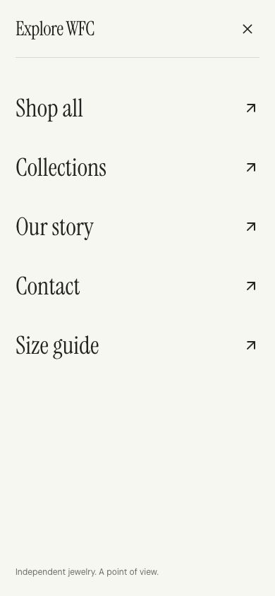

# Laporan mobile view dan hamburger menu WFC

Tanggal: 26 Oktober 2026. Audit read-only oleh agen utama melalui browser dan agen pendamping mobile_nav_audit melalui kode. Tidak ada perubahan implementasi.

## Ringkasan

Palet netral, tipografi, serta menu ivory sudah selaras. Hamburger berfungsi dan memakai native dialog. Masalah utama adalah penutupan menu pada route yang sama, menu yang tetap terbuka saat layar melebar, ukuran target sentuh, dan posisi CTA pada hero awal.

## Lingkup pemeriksaan

- Viewport browser 390 × 844 dan 320 × 568.
- Perubahan viewport ke 900 × 700 ketika menu terbuka.
- Membuka menu, Escape, fokus kembali, navigasi menuju Our story dan memilih kembali route yang sama.
- Pemeriksaan homepage mobile, koleksi, bagian produk, dan FAQ; bukan audit seluruh halaman toko/checkout.
- Pemeriksaan DOM, dimensi tombol, CSS breakpoint, dan komponen Overlay.
- Belum diuji pada iPhone/Android fisik, pembaca layar, atau dengan profiling FPS. Swipe sentuh tidak divalidasi oleh pengujian ini.

## Yang sudah berjalan baik

- Menu memakai native dialog dengan showModal dan judul terhubung, sehingga pembatasan interaksi modal ditangani browser.
- Saat dibuka pada 390 × 844, fokus berpindah ke tombol Close.
- Escape menutup menu dan fokus kembali ke hamburger pada pengujian browser.
- Link ke route berbeda menutup menu setelah navigasi.
- Kode mengunci body scroll selama dialog terbuka dan memulihkannya saat ditutup.
- Menu mobile menggunakan daftar yang mudah dipindai dengan teks besar dan jarak yang lapang.
- Pada homepage 390 px tidak ditemukan overflow horizontal dokumen dalam pemeriksaan awal.
- FAQ dan panel koleksi sudah mengikuti warna ivory, charcoal, dan silver.

## Temuan dan prioritas

| Prioritas | Temuan | Bukti dan dampak | Rekomendasi |
|---|---|---|---|
| P1 | CTA hero melewati layar awal | Pada 390 × 844, tombol Explore the collection berada pada y=833–885. Tombol tidak tampil utuh sebelum scroll; detail hero kemudian mulai memudar saat scroll | Hitung tinggi hero terhadap header/announcement, atau tata ulang ruang foto dan teks agar CTA tampil utuh. Pastikan tombol masih dapat dipakai sebelum fase pengecilan |
| P1 | Target sentuh header kecil | DOM menunjukkan hamburger dan search sekitar 31 × 34 px; bag sekitar 26 × 18 px | Gunakan area sentuh 44 × 44 px dengan ikon tetap kecil. Ini sasaran kenyamanan, bukan klaim seluruh target gagal WCAG |
| P2 | Memilih halaman aktif tidak menutup menu | Teruji di /about: pilih Our story lagi, menu tetap terbuka dan body tetap terkunci. Penutupan bergantung pada perubahan pathname | Tutup menu di handler klik setiap link, pertahankan effect route sebagai pengaman |
| P2 | Menu tertinggal setelah viewport melebar | Saat diubah ke 900 × 700, dialog masih open sementara hamburger tidak terlihat | Tutup menu ketika breakpoint desktop 801 px ke atas aktif |
| P2 | Status menu dan halaman aktif tidak jelas | Hamburger tidak memiliki aria-expanded/controls; menu tidak menandai route aktif dengan aria-current | Hubungkan pemicu dan dialog, nyatakan status terbuka, tambahkan penanda halaman aktif |
| P2 | Harga produk tidak konsisten penempatannya | Pada grid 390 px, harga Fold Earrings sejajar judul sedangkan harga Continuum Bracelet turun ke baris tersendiri | Di mobile letakkan nama, material, lalu harga pada susunan vertikal yang konsisten; tetap gunakan dua kolom selama lebar memadai |
| P3 | Menu layar pendek perlu scroll | Pada 320 × 568, link utama masih terlihat tetapi catatan bawah berada di bawah area awal; panel memiliki scrollbar | Pertahankan scroll internal; rapatkan padding vertikal secara adaptif untuk layar pendek. Pastikan tombol Close selalu mudah dijangkau |
| P3 | Transisi menu belum memiliki gerak khusus | Dialog tampil tanpa animasi menu yang dirancang khusus; panel berorientasi kanan meskipun pemicu ada di kiri | Pilih menu penuh mobile atau panel kiri, dengan animasi opacity/translate 200–300 ms dan reduced-motion fallback |
| P3 | Safe area belum ditangani eksplisit | Panel memakai padding tetap tanpa env(safe-area-inset-*) | Uji perangkat ber-notch dan landscape sebelum menambahkan inset yang diperlukan |

P1/P2 di sini adalah urutan pekerjaan yang disarankan untuk proyek, bukan penetapan tingkat pelanggaran standar.

## Rekomendasi tampilan

1. Pertahankan menu ivory dan teks charcoal. Tidak perlu menambahkan warna aksen baru.
2. Jadikan Shop all, Collections, dan Our story kelompok utama. Contact dan Size guide dapat memakai ukuran lebih kecil atau dipisahkan garis agar hierarki lebih jelas.
3. Tandai halaman aktif dengan garis bawah atau titik charcoal; jangan bergantung hanya pada perubahan warna.
4. Pertahankan menu penuh pada layar sempit. Atur ukuran teks responsif sekitar 28–34 px dan jarak link yang tetap nyaman.
5. Gunakan petunjuk “Geser untuk melihat koleksi” untuk bagian swipe apabila bahasa situs nantinya dilokalkan; untuk situs berbahasa Inggris gunakan “Swipe to explore”. Petunjuk saat ini “Scroll to explore” kurang spesifik pada rail mobile.
6. Pertahankan foto koleksi yang utuh, namun kurangi ruang kosong berlebih jika komposisi landscape dimasukkan ke panel portrait. Atur tiap foto berdasarkan titik fokus produk, tanpa memotong setting penting.
7. Prioritaskan CTA hero yang terlihat penuh dan dapat ditekan. Efek sinematik sebaiknya dimulai setelah pengguna sempat membaca dan memilih tindakan.

## Urutan implementasi yang disarankan

Tahap pertama: benahi CTA hero, target sentuh, close pada link route aktif, dan reset menu saat resize.

Tahap kedua: lengkapi status aksesibilitas, penanda route aktif, dan susunan harga produk.

Tahap ketiga: haluskan animasi menu, hirarki tautan, serta padding layar pendek/safe area.

## Verifikasi setelah perbaikan

- Periksa 320 × 568, 390 × 844, 430 × 932, serta landscape.
- CTA awal tampil utuh dan dapat diklik sebelum scroll.
- Semua tombol header dan Close memiliki area sentuh yang konsisten.
- Menu menutup saat link halaman sama maupun berbeda dipilih.
- Escape mengembalikan fokus; Tab dan Shift+Tab tetap berada dalam dialog modal.
- Resize ke desktop menutup menu dan mengembalikan scroll halaman.
- Harga produk tidak berpindah susunan secara tidak konsisten.
- Uji reduced motion, safe area, dan swipe pada ponsel fisik.

## Referensi kode

- src/components/site-shell.tsx:55 — Overlay native dialog dan scroll lock.
- src/components/site-shell.tsx:225 — penutupan berdasarkan pathname.
- src/components/site-shell.tsx:241 — pemicu hamburger.
- src/components/site-shell.tsx:350 — daftar navigasi mobile.
- src/app/globals.css:2789 — breakpoint navigasi 800 px.
- src/app/globals.css:3204 — target ikon header mobile.
- src/app/globals.css:5851 dan seterusnya — koreografi hero mobile.

## Bukti visual

## Perbaikan setelah persetujuan

CTA hero kini terlihat utuh pada viewport 390 × 844 (batas bawah 780 px) dan 320 × 568 (544 px). Ketiga tombol header terukur 44 × 44 px. Menu menutup saat memilih route aktif dan saat resize ke desktop; body scroll dipulihkan. Status expanded/controls dan penanda aria-current ditambahkan. Hirarki menu, safe-area padding, animasi masuk ringan dengan reduced-motion fallback, serta susunan harga produk mobile diperbaiki. Build produksi lulus. Pengujian menggunakan browser responsif, bukan perangkat fisik.
