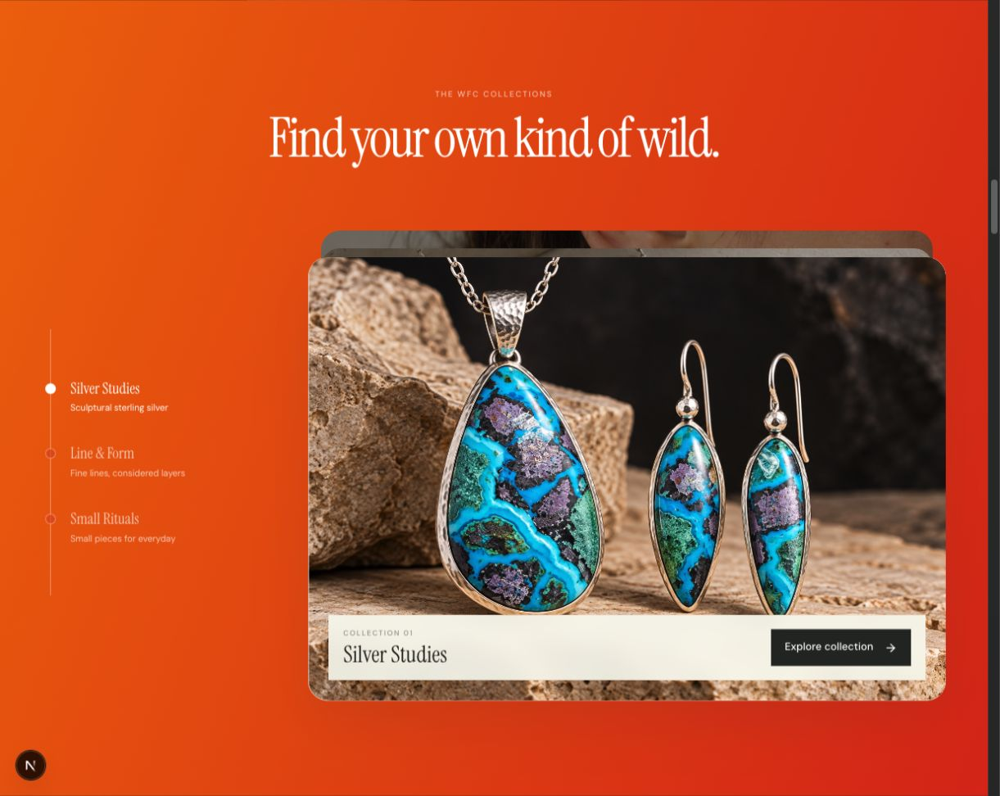
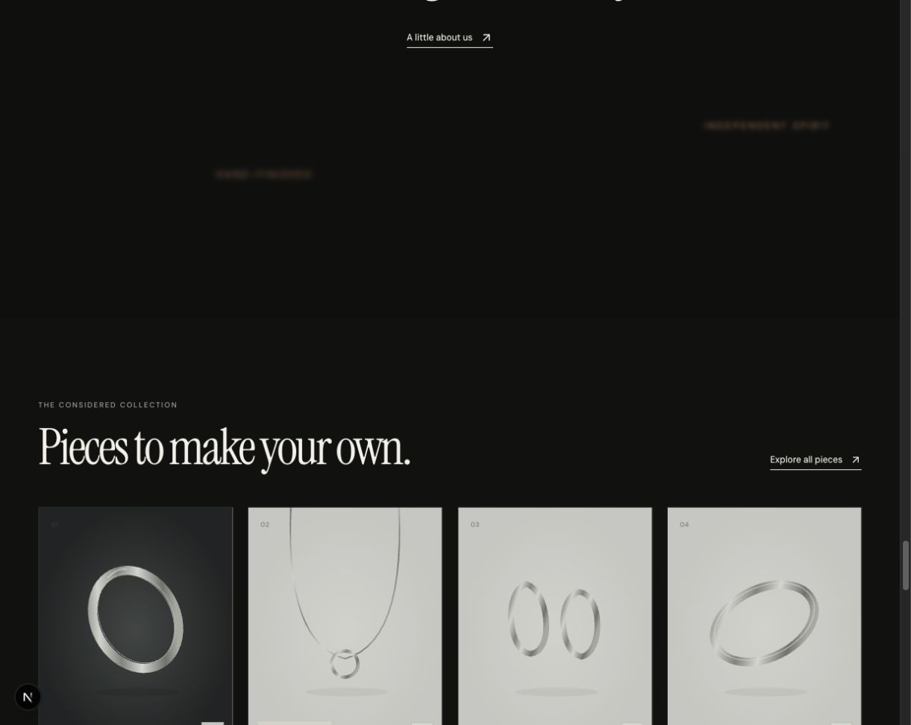

# Audit visual dan transisi WFC

Tanggal: 26 Oktober 2026.

Kesimpulan: fondasi WFC sudah menarik, terutama foto batu, warna material alami, dan judul serif. Namun, halaman saat ini masih memperlihatkan pertemuan dua arah: editorial perhiasan yang tenang dan portfolio digital yang sangat ekspresif. Penyempurnaan terbesar berasal dari penyatuan palet, konsistensi foto, dan ritme scroll—bukan penambahan efek.

Audit ini berupa evaluasi dan rekomendasi. Tidak ada perubahan kode tampilan dalam sesi audit ini.

## Dasar dan batas pemeriksaan

- Pemeriksaan visual desktop pada localhost:3000: hero pembuka, pengecilan ke kolase, sapuan lengkung, koleksi, dan produk.
- Pembandingan dengan referensi Elena Voss yang telah diperiksa dari hero hingga footer dalam sesi sebelumnya.
- Pemeriksaan CSS, pengendali scroll, struktur komponen, serta dimensi dan ukuran file foto lokal.
- Rasio kontras dihitung dari nilai warna CSS, bukan pengukuran seluruh piksel hasil render.
- Penilaian konsep dan komposisi adalah pertimbangan desain. Risiko kelancaran dibedakan dari hasil pengukuran performa.
- Belum ada rekaman frame-time/FPS, pengujian perangkat mobile fisik, audit Lighthouse, atau pengukuran conversion rate. Karena itu laporan ini tidak menyatakan animasi sudah konsisten 60 FPS atau mobile sudah tervalidasi.

## 1. Konsep dan identitas

Yang sudah kuat:

- Carnelian pada hero memberikan pusat perhatian yang mudah diingat.
- Tekstur batu, silver, permukaan plaster, dan cahaya hangat mendukung karakter handmade.
- Serif yang ramping dan italic menghasilkan karakter editorial yang sesuai dengan perhiasan.
- Foto pemakaian dan proses kerja dalam kolase memberi variasi cerita.

Yang perlu disatukan:

- Header ivory, panel koleksi oranye-merah menyala, dan rangkaian panjang bagian hitam terasa seperti tiga suasana yang berbeda.
- Referensi memakai warna panas sebagai identitas portfolio kreatif. Pada WFC, warna batu dan material seharusnya tetap menjadi pusat perhatian.
- Koleksi ditampilkan kembali sebagai hero, kartu material, lalu daftar. Pengulangan ini perlu memiliki fungsi berbeda agar pengguna tidak merasa membaca katalog yang sama tiga kali.
- Produk dengan harga baru muncul setelah perjalanan visual yang panjang. Secara desain ini berisiko memperlambat orang yang datang untuk berbelanja; dampak penjualannya belum diukur.

Rekomendasi konsep: **editorial perhiasan alami dengan gerak sinematik yang terukur**. Pertahankan struktur dan urutan transisi referensi, sambil mengambil keputusan warna, foto, dan kepadatan konten berdasarkan WFC.

## 2. Warna dan kontras

| Elemen | Kondisi sekarang | Penilaian | Rekomendasi |
|---|---|---|---|
| Header | Ivory terang | Bersih tetapi terasa terpisah dari hero | Pertahankan ivory dan samakan dengan panel informasi serta latar foto |
| Hero | Taupe, silver, carnelian | Bagian paling selaras | Jadikan sumber palet utama |
| Panel koleksi | Gradasi #ED6909 → #D82818 | Enerjik, tetapi bersaing dengan cyan pada chrysocolla | Coba carnelian lebih gelap atau warm ivory; pertahankan bentuk sapuan |
| Bagian bawah | #0C0D0B dengan teks terang | Dramatis, tetapi panjang dan relatif seragam | Sisipkan satu bagian ivory untuk produk atau craft |
| CTA penutup | Cahaya oranye | Menghubungkan dengan warna batu | Kurangi saturasi agar terasa sebagai pantulan cahaya |
| Label kecil | Opacity berlapis | Terlalu samar di beberapa area | Atur warna teks langsung dan hindari opacity pada seluruh kelompok |

Temuan terukur:

- Putih murni pada #ED6909: sekitar **3,17:1**.
- Putih murni pada #D82818: sekitar **4,96:1**.
- Putih murni pada #0C0D0B: sekitar **19,48:1**.

Sisi oranye paling terang belum cukup untuk teks normal berwarna putih berdasarkan ambang 4,5:1. Navigasi nonaktif memakai opacity, dan label juga dapat memiliki opacity sendiri, sehingga kontrasnya lebih rendah lagi. Ini merupakan masalah keterbacaan; judul besar perlu dinilai terpisah.

Acuan: [W3C — Contrast Minimum](https://www.w3.org/WAI/WCAG22/Understanding/contrast-minimum.html), dengan ambang 4,5:1 untuk teks normal dan 3:1 untuk teks besar.

Palet usulan untuk diuji, bukan warna final yang sudah diterapkan:

| Peran | Warna usulan |
|---|---|
| Ivory | #F3EFE6 |
| Charcoal hangat | #191A17 |
| Taupe | #B5A48D |
| Carnelian gelap | #8B3426 |
| Silver | #CACCC5 |
| Teks sekunder di latar gelap | #C2BDB3 |

Rasio penggunaan awal: dominan netral; carnelian sebagai bidang fokus terbatas; warna cyan dan kuning berasal terutama dari foto batu. Semua pasangan teks/latar perlu diuji kembali setelah ditentukan.

## 3. Foto dan aset

### Hero utama

File wfc-hero.jpg berukuran **1024 × 1536**, sekitar **362 KB**. Gambar portrait ini dipakai sebagai latar lebar dengan object-fit: cover. Pada layar desktop, gambar harus diperbesar dan sebagian area vertikal dipotong. Pada layar retina, ruang detail yang tersedia makin terbatas.

Rekomendasi:

- Siapkan versi landscape khusus desktop, sekitar 2400 × 1500 atau lebih sesuai komposisi, dari foto asli beresolusi cukup.
- Tempatkan cincin di kanan, dengan ruang tenang di kiri untuk judul.
- Pertahankan versi portrait untuk mobile dengan titik fokus tersendiri.
- Jangan hanya memperbesar file yang sama dan menganggap detail baru telah tersedia.
- Jaga warna carnelian, bentuk setting, dan proporsi produk tetap setia terhadap barang sebenarnya.

### Hero koleksi

- Chrysocolla: **1536 × 1024**, sekitar **568 KB**. Formatnya paling sesuai untuk panel landscape; detail dan warna kuat.
- Clown Doublet: **1122 × 1402**, sekitar **424 KB**. Format portrait akan banyak terpotong pada panel landscape. Posisi center bottom membantu menunjukkan pendant, tetapi perlu dicek per ukuran layar.
- Bumble Bee Jasper: **1122 × 1402**, sekitar **307 KB**. Foto pemakaian memberi konteks ukuran, tetapi produknya jauh lebih kecil daripada chrysocolla dalam panel yang sama.

Masalah utama: skala subjek tidak seragam. Pergantian dari pendant besar ke earring kecil terasa sebagai perubahan bobot visual yang kuat.

Rekomendasi: tetapkan satu aturan framing—misalnya produk atau kelompok produk mengisi sekitar 45–60% area penting—dan gunakan pasangan still-life / worn untuk tiap koleksi. Jangan melakukan crop terlalu dekat sampai hook, rantai, atau setting kehilangan konteks.

### Kolase dan pengulangan

Foto editorial lain berukuran **1122 × 1402**, sekitar **308–438 KB**. Kolase dua kali dua memakai foto portrait pada sel lebar, sehingga sebagian informasi terpotong.

Gunakan kombinasi yang memiliki fungsi berbeda:

1. Makro batu / silver.
2. Produk utuh.
3. Produk saat dipakai.
4. Proses pembuatan atau tangan perajin.

Foto koleksi yang sama saat ini muncul kembali pada kartu material dan daftar koleksi. Tambahkan sudut berbeda, bukan hanya mengulang file yang sama dengan crop berbeda.

### Foto produk jual

Bagian produk memakai aset SVG bergaya ilustrasi/render sederhana. Secara visual, tekstur dan detailnya tidak sejalan dengan foto editorial di atasnya. Pengguna berpindah dari perhiasan bertekstur ke gambar katalog yang sangat abstrak.

Prioritas tinggi: gunakan foto aktual produk yang benar-benar ditawarkan. Tiap produk idealnya memiliki foto utuh, makro setting, dan foto pemakaian untuk skala. Samakan arah cahaya, temperatur warna, serta latar tanpa mengubah warna alami batu.

Tombol tambah dan badge pada foto produk juga tampak sangat pucat. Keduanya perlu warna ikon/teks yang lebih tegas dan status fokus yang jelas.

### Penyajian gambar

Komponen saat ini memakai img biasa tanpa srcset/sizes pada bagian hero dan koleksi. Rekomendasikan ukuran responsif, dimensi intrinsik, dan format WebP/AVIF setelah pembandingan kualitas. Jangan memuat foto hero berikutnya terlalu terlambat; siapkan sebelum tahapnya masuk viewport. Ukur dampaknya pada jaringan nyata, bukan hanya dari ukuran file lokal.

## 4. Kehalusan transisi

### Hero 1 → Hero 2

Kekuatan: objek yang sama tetap terlihat ketika frame mengecil, sehingga hubungan antartahap jelas.

Kekurangan: seluruh teks dan tombol ikut mengecil sampai sekitar 50%. CTA masih terlihat seperti elemen yang bisa dipakai, tetapi menjadi terlalu kecil untuk menjadi fokus interaksi.

Rekomendasi: pertahankan pengecilan frame dan foto. Pudarkan deskripsi, label kecil, serta CTA secara bertahap sebelum mencapai ukuran kartu. Sisakan judul dan objek sebagai identitas visual. Sisipkan jeda kolase yang cukup sebelum kurva masuk.

### Hero 2 → Hero 3

Kekuatan: sapuan lengkung sudah memberi perpindahan yang berbeda dari fade biasa.

Kekurangan: isi koleksi dan foto mulai terlihat melalui area sapuan saat bidangnya belum memenuhi layar. Akibatnya, perhatian terpecah antara kartu hero lama, foto baru, dan teks yang terpotong kurva.

Rekomendasi urutan:

1. Kolase terbaca.
2. Bidang lengkung masuk.
3. Bidang hampir memenuhi layar.
4. Judul koleksi masuk.
5. Timeline dan foto tampil penuh.

Buat perpindahan heading dan panel terikat kemajuan sapuan, bukan hanya mengandalkan clipping seluruh isi.

### Pergantian koleksi

Kode memakai Math.floor untuk mengganti indeks pada ambang scroll, kemudian CSS menganimasikan perubahan selama 700 ms. Ini berbeda dengan animasi yang posisinya terus mengikuti scroll: saat scroll cepat, pengguna bisa melewati beberapa indeks sebelum transisi selesai.

Rekomendasi: gunakan kemajuan lokal setiap slide untuk posisi, clip, atau opacity. Jika tetap memakai pergantian diskret, batasi perpindahan dan tambahkan hysteresis agar scroll kecil di sekitar ambang tidak bolak-balik mengganti slide. Uji arah turun, naik, dan klik navigasi.

### Kartu horizontal

Kode menggerakkan rail langsung dari posisi scroll melalui requestAnimationFrame. Itu menyelaraskan pembaruan dengan render browser, tetapi tidak dengan sendirinya membuat easing atau momentum halus.

Rekomendasi: tentukan apakah rail harus menempel langsung pada scroll atau memiliki sedikit pelunakan. Jika memakai pelunakan, lag harus kecil dan berhenti cepat. Jangan menghalangi scroll native. Tambahkan petunjuk bahwa bagian ini bergerak horizontal dan pastikan kartu terakhir dapat dicapai melalui keyboard.

### Ritme halaman

Hero memakai tinggi 500svh dan rail 260svh pada desktop. Itu berarti kedua area memakai total panjang layout 7,6 kali tinggi viewport sebelum menghitung bagian lain. Ini bukan waktu baca tetap; durasinya tergantung input pengguna.

Rekomendasi percobaan: pendekkan hero ke sekitar 380–420svh dan rail ke 180–220svh, lalu uji apakah tiap koleksi masih mendapat waktu tampil yang cukup. Sediakan jalur “Shop all” yang mudah dijangkau selama perjalanan.

### Reveal bagian bawah

Opacity awal 0,12 dan transisi 800–900 ms dapat membuat bagian terlihat sangat redup ketika pengguna baru masuk. Rekomendasi: opacity awal lebih tinggi atau reveal hanya pada judul dan gambar; teks penting tetap terbaca. Pakai gerak 12–24 px dengan durasi sekitar 450–650 ms sebagai titik awal pengujian.

### Performa dan implementasi

Blur pada kolase dan clip-path besar perlu diprofilkan karena dapat menambah biaya rendering. Belum ada bukti pengukuran bahwa keduanya menyebabkan frame drop pada perangkat pengguna.

Periksa pula reset mode: ketika berpindah ke reduced motion atau layout kecil setelah scroll, state inert hero perlu tetap sinkron. Saat ini callback scroll dapat memasang inert kembali berdasarkan progress, sementara pengaturan static mode berjalan melalui listener berbeda. Ini perlu uji khusus sebelum menyatakan aksesibilitasnya selesai.

## 5. Prioritas pelaksanaan

| Urutan | Tindakan | Dampak yang dituju |
|---|---|---|
| P1 | Perbaiki kontras timeline, badge, tombol tambah | Keterbacaan dan kejelasan belanja |
| P1 | Seragamkan foto produk nyata dengan editorial | Kepercayaan dan konsistensi |
| P1 | Siapkan hero desktop landscape dan crop mobile | Ketajaman serta komposisi |
| P1 | Rapikan urutan sapuan dan pergantian slide | Gerak lebih mudah diikuti |
| P2 | Turunkan dominasi gradasi oranye | Perhiasan kembali menjadi fokus |
| P2 | Pendekkan area sticky dan rapikan pengulangan konten | Perjalanan lebih ringkas |
| P2 | Bedakan foto per bagian dan skala subjek | Cerita visual lebih kaya |
| P2 | Konsistenkan radius, CTA, dan ukuran label | Tampilan terasa satu sistem |
| P3 | Tambahkan foto craft dan pemakaian yang relevan | Kedalaman cerita merek |
| P3 | Profil frame-time, gambar, serta jaringan | Validasi optimasi |

## 6. Kriteria selesai yang disarankan

- Tidak ada teks operasional yang samar pada sisi paling terang gradasi.
- Hero, kolase, dan panel koleksi punya tahap baca yang jelas saat scroll lambat maupun cepat.
- Arah scroll terbalik tidak menyebabkan pergantian gambar berkedip.
- Gambar koleksi tidak memotong bagian produk penting pada lebar 390, 768, 1440, dan 1920 px.
- Versi mobile dan reduced motion diuji langsung, termasuk keyboard dan fokus.
- Produk yang ditampilkan memiliki visual yang sesuai barang sebenarnya.
- Nama produk, harga, badge, dan tombol tambah jelas tanpa hover.
- Tidak ada klaim kelancaran berbasis FPS sebelum profiling.

## Rekomendasi keputusan

Pertahankan foto hero carnelian, tipografi editorial, kolase, dan sapuan melengkung. Fokuskan iterasi berikutnya pada empat hal: **palet yang lebih menyatu, fotografi produk yang konsisten, perpindahan koleksi yang mengikuti scroll dengan baik, dan perjalanan belanja yang lebih singkat**. Ini akan mempertahankan daya tarik referensi sambil memberi WFC karakter yang lebih kuat.

## Bukti visual desktop

Panel koleksi:

Peralihan editorial menuju produk:

## Implementasi setelah persetujuan

- Mengganti panel oranye terang dengan carnelian gelap, serta menyamakan ivory dan charcoal.
- Memperkuat kontras timeline, label, badge, dan tombol tambah; menambah indikator fokus.
- Memberi latar ivory pada bagian produk untuk membedakan fase belanja.
- Memendekkan hero dari 500 menjadi 400svh dan rail dari 260 menjadi 200svh.
- Menghaluskan pengecilan dengan smoothstep, memudarkan detail hero, dan menunda isi koleksi sampai sapuan hampir selesai.
- Mengikat reveal gambar koleksi ke posisi scroll; menghapus transisi waktu 700ms yang dapat tertinggal dari scroll.
- Mengurangi jarak/durasi reveal bagian bawah dan menaikkan opacity awal.
- Menghapus blur kolase, memperbaiki panjang rail, dan menambahkan penanganan fokus kartu horizontal.
- Mengoptimalkan hero ke WebP tanpa mengubah produk pada gambar.

Aset yang masih diperlukan: foto landscape asli untuk hero desktop dan foto katalog aktual yang sesuai setiap SKU. Aset product-concepts tidak dipakai sebagai bukti foto aktual. Pengujian browser desktop dan build dilakukan; pengujian perangkat mobile fisik serta profiling FPS tetap belum dilakukan.
